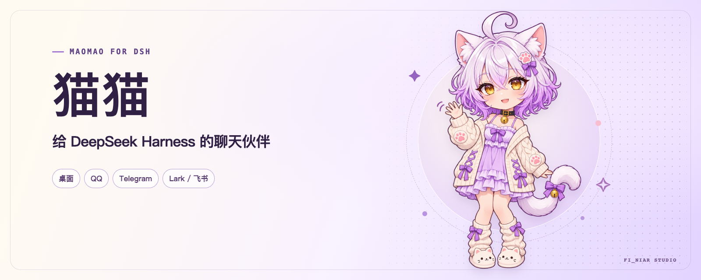

# 猫猫 · Maomao for DSH

猫猫是一个适用于 [DeepSeek Harness（DSH）](https://github.com/deepseek-ai/deepseek-harness) 的开源聊天伙伴插件。你可以在 DSH 里直接和猫猫聊天，也可以把自己的 QQ、Telegram 或 Lark / 飞书机器人接进同一个控制面板。

- **桌面聊天**：新建会话时选择「猫猫」预设，即可使用内置人格和独立的本地记忆。
- **聊天平台**：在面板里接入自己的 Bot、绑定会话，再验证首条回复。
- **按需扩展**：单独配置模型、普通记忆、人格、媒体与主动分享。基础文字聊天可以跟随 DSH 默认模型。

## 安装

目前验证的 DSH 版本为 **`0.2.2-rc.1`**。请先在 DSH 的模型设置中准备一个可用的对话模型。使用外部渠道的记忆和分享功能时，还需要系统可调用的 Python 3。QQ 表情缩略图需要 [Pillow](https://pillow.readthedocs.io/)。

在桌面端打开「插件 → 安装第三方插件」，输入 `maomao-dsh-panel@0.2.24`，安装后按提示重启。也可以下载并导入 `.tgz` 安装包。[GitHub Releases](https://github.com/ififi2017/dsh-plugin-maomao/releases)

Web 版可以用 DSH 命令行从 npm 安装固定版本。[npm 包](https://www.npmjs.com/package/maomao-dsh-panel/v/0.2.24)

```sh
dsh plugin --profile web add maomao-dsh-panel@0.2.24
```

也可以从 GitHub 安装同一个版本。

```sh
dsh plugin --profile web add 'github:ififi2017/dsh-plugin-maomao#v0.2.24'
```

重启后打开「设置 → 猫猫 → 开始使用」。只在 DSH 聊天的话，直接在新会话的模式菜单选「猫猫」，发一句「猫猫你好」。

## 第一次接入聊天平台

先选一个平台走通 **连接 Bot → 绑定会话 → 验证第一条回复**。面板会分别显示连接、配对和这条测试消息的处理进度。

| 渠道 | 准备什么 | 怎么绑定 |
| --- | --- | --- |
| Lark / 飞书 | 选对 Lark 或飞书版本，扫码创建应用，或导入已有 App ID 和 App Secret。应用需启用机器人能力和长连接事件，并发布版本 | 在目标私聊发配对指令，把 Bot 回的确认码填回面板 |
| Telegram | 在 [BotFather](https://t.me/BotFather) 创建 Bot，将 Token 填到面板。已有开启管理模式的 Bot 也可以扫码创建 | 打开配对链接点 Start，或在私聊发配对指令，再填确认码 |
| QQ | 扫码授权或导入 App ID 和 App Secret。先确认同一个 Bot 只由一个实例连接 | 选择群或私聊。群内先 @Bot，再发送配对指令，最后填确认码 |

绑定后点「生成测试消息」，把带编号的整句发到选定会话。QQ 群内需要 @Bot。面板会显示同一条消息的收件、模型和投递结果。平台接受回复后，回到聊天窗口确认。

Lark / 飞书手动配置时，订阅 `im.message.receive_v1`，启用 `im:message.p2p_msg:readonly` 和 `im:message:send_as_bot`。需要读图时再开 `im:resource` 和 `im:message:readonly`。改完权限或事件后，在平台发布新版应用，再回面板验证。

## 按需配置

| 面板 | 能做什么 |
| --- | --- |
| 模型 | 对话模型跟随 DSH 或单独设置。「展开可选模型」可配置识图、QQ 生图与语音，以及 Embedding |
| 人格 | 查看猫猫设定、添加角色、给会话切换人格或重开会话 |
| 记忆库 | 查看桌面、已绑定私聊和 QQ 群的普通记忆及其来源 |
| 记忆与主动分享 | 管理普通记忆、向量索引、私聊共享、分享目标和免打扰时段 |
| 诊断 | 查最近的收件、模型和投递结果，以及媒体下载失败原因 |

绑定第二个 Lark / 飞书或 Telegram 私聊时，可关联同一位主人，也可为另一人建立独立记忆。关联同一位主人并开启共享后，两端才共享普通记忆。QQ 群记忆按 Bot 和群隔离。主动分享默认关闭，可以先用试跑查看候选内容。

凭据由 DSH 凭据库管理。普通记忆和绑定保存在运行实例的本地目录。聊天、图片或向量请求会按配置发给所选模型服务。公开源码只包含通用配置和合成测试资料。

## 欢迎二次开发

欢迎提出改进建议、提交 PR，或 Fork 后扩展人格、渠道和设置界面。开发需要 Node.js `>=24.9`、Python 3，以及用于 QQ 图片测试的 Pillow。

```sh
git clone https://github.com/ififi2017/dsh-plugin-maomao.git
cd dsh-plugin-maomao
npm ci --ignore-scripts
npm test
npm run pack:release
```

- [贡献指南](CONTRIBUTING.md)有源码入口、隔离测试方法和发版步骤。
- [DSH 官方 bundle 发布文档](https://github.com/deepseek-ai/deepseek-harness/blob/master/docs/user/develop/basic/publish.md)介绍了清单、patch 和安装方式。
- 代码采用 [MIT 许可证](LICENSE)。猫猫形象和宣传图见[素材说明](assets/NOTICE.md)。

这是社区插件，由 fi_niaR Studio 维护。
